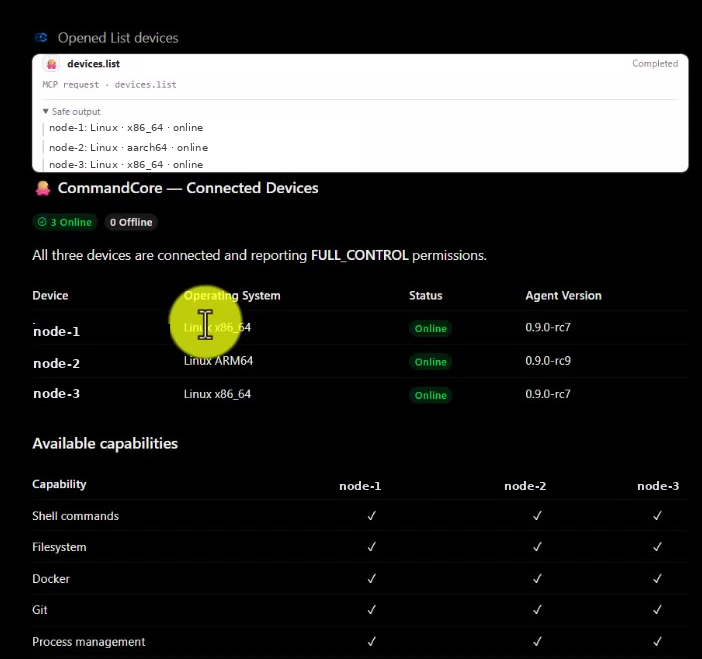
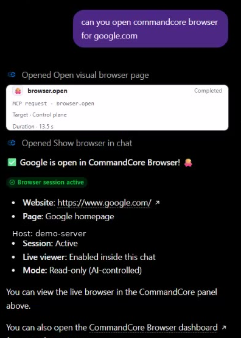
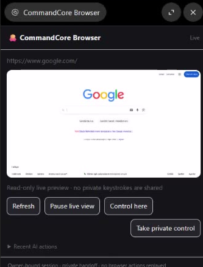
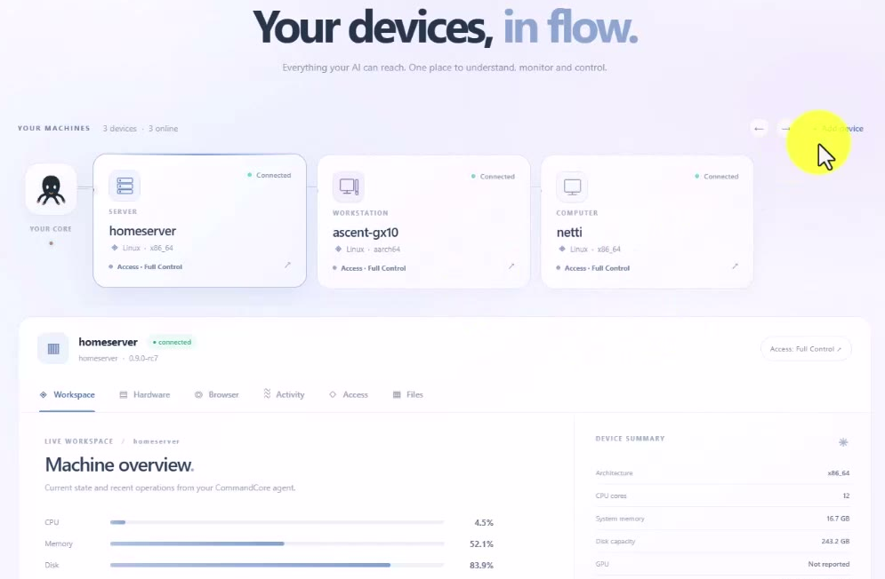
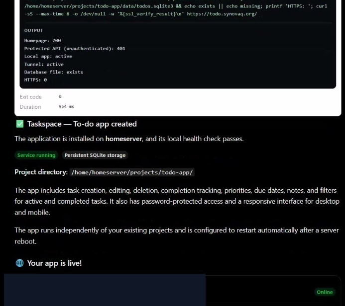

# CommandCore

  

**Self-hosted remote computer control for AI and MCP clients.**

CommandCore connects AI clients to one or more computers through a vendor-neutral
MCP control plane. Devices make outbound connections to the server, retain their
own cryptographic identity, and enforce local permission ceilings.

CommandCore is free software licensed under **GNU AGPL-3.0-or-later**.

> **Project status:** 0.9 release-candidate family. Linux is the primary supported
> platform. Windows support is a preview. Interactive desktop control is
> experimental and is not yet part of the stable support promise.

## See CommandCore in action

These are **real interface captures** from the November 2026 CommandCore 1080p video demonstration. They are cropped, and machine names, private URLs, file paths, and selected command text have been replaced with generic examples for privacy. The underlying interface and results are real; these are **edited captures, not AI-generated mockups**. Select an image to view it at full resolution.

### 1. Discover your devices from ChatGPT

Ask an MCP-connected assistant to list your authorized machines and see their operating systems, status, and available capabilities — without copying terminal commands.

  

Recorded demo: FULL_CONTROL is enabled on the author's test devices; this is not the default permission recommendation.

### 2. Open a live Browser inside the same conversation

The assistant opens a managed Browser session, reports the result, and shows a live view in ChatGPT. Human control is explicitly separate from AI control.

  
  

Two crops from the same real demonstration frame. The managed Browser is optional and experimental; see the <a href="docs/BROWSER.md">Browser guide</a>.

### 3. Monitor your devices from the web workspace

The web interface provides a second view of the same devices: their online state, machine metrics, available tools, Browser sessions, and recent execution activity.

  

### 4. Follow work through execution and verification

In this recorded example, the assistant set up a small test application and checked its service and HTTP result. The verification status and output are taken from that session. Private deployment paths and command arguments shown in the image have been anonymized.

  

The temporary to-do application in this historic walkthrough was later removed; this is an example workflow, not a currently hosted service.

For a longer tour, see the [video demonstration](https://youtu.be/kRVtG7oW1aQ) and explore the [public website](https://commandcore.app/).

## Why CommandCore?

Most computer-control MCP tools focus on one client talking to one machine.
CommandCore is designed as a control plane:

The architecture graphic at the top illustrates the request path: AI clients connect over MCP and OAuth to CommandCore, which authorizes operations and routes them to enrolled devices over outbound connections.

A single MCP endpoint can expose every device the authenticated account is
allowed to use. Adding a device does not require adding another MCP server to
each AI client.

### Core properties

- **Self-hosted control plane** - server, protocol, agent, and deployment tooling
  are in this repository.
- **Vendor-neutral MCP** - the control plane does not depend on one AI provider.
- **Multi-device by design** - enumerate, select, and operate authorized devices.
- **Outbound-only device transport** - enrolled devices do not need inbound
  command ports.
- **Cryptographic device identity** - each agent keeps its Ed25519 private key
  locally.
- **Layered authorization** - OAuth scope, account-to-device grant, server
  profile, and device-local ceiling all restrict effective authority.
- **Privilege separation on Linux** - optional FULL_CONTROL uses a separate
  local privileged helper rather than making the network-facing agent root.
- **Auditable operations** - remote work is associated with identity, device,
  request, and execution metadata.
- **Managed long-running jobs** - process handles and bounded output survive
  transport/server reconnects in the native Linux agent.
- **Signed agent releases** - integrity verification, versioned installation,
  health validation, and rollback are first-class lifecycle concerns.

## Security model

CommandCore intentionally does not treat enrollment as authorization.

~~~text
effective authority =
    OAuth scope
    AND account -> device grant
    AND server permission profile
    AND device-local permission ceiling
~~~

Profiles:

| Profile | Meaning |
|---|---|
| READ_ONLY | Inspect permitted state and files |
| STANDARD | Normal operating-system authority of the agent user |
| FULL_CONTROL | Explicit local privileged-helper opt-in |

STANDARD shell access is powerful: it has the same authority as the operating
system account running the agent. Run the agent as a dedicated unprivileged user
when stronger host separation is required.

Read [SECURITY.md](SECURITY.md), [Security model](docs/SECURITY_MODEL.md), and
[Threat model](docs/THREAT_MODEL.md) before exposing a deployment to untrusted
clients.

## Capabilities

The current Linux implementation covers:

- filesystem list/stat/read/write/patch/search/copy/move/delete;
- shell execution;
- managed processes, status, output, and cancellation;
- system information and metrics;
- upload/download transfer primitives;
- Git operations;
- device enrollment, revocation, reconnect, and key rotation;
- OAuth-protected MCP access and explicit device grants;
- signed agent installation/update/rollback;
- fleet/canary rollout primitives;
- optional privilege-separated Linux FULL_CONTROL.

The optional managed Browser supports public web search, page inspection,
scoped links, navigation history, and private human control. See the
[Browser guide](docs/BROWSER.md) for its deployment boundary and limits.
Interactive desktop control and some platform administration remain experimental. The project
does not claim support from compilation alone; see the
[platform matrix](docs/PLATFORM_SUPPORT.md).

## Install with an AI agent

CommandCore includes a root-level [AGENTS.md](AGENTS.md) with repository-specific
instructions for coding and operations agents, plus a human-readable
[agent-assisted installation guide](docs/AGENT_ASSISTED_INSTALL.md).

A capable agent with access to the target server can inspect the machine,
prepare the deployment, start CommandCore, configure the pieces it has authority
to configure, and verify the result. Account-bound steps such as DNS ownership,
OAuth provider login, MFA, or permission decisions remain with the operator.

A portable starting prompt is:

~~~text
Clone https://github.com/bazobehram/commandcore.git and read AGENTS.md before
making any changes.

Install a self-hosted CommandCore server on this machine and make it usable for
remote MCP clients. Preserve the documented security model: keep the internal
application port private, use HTTPS/WSS for remote access, configure OAuth/OIDC
instead of leaving public bootstrap enabled, and do not enable FULL_CONTROL
unless I explicitly request it.

Inspect the machine first. Ask me only for account-bound information you cannot
safely infer. Verify /healthz and the MCP path, perform a read-only acceptance
test when a device is enrolled, and finish with the exact public URL, MCP URL,
Agent URL, OAuth status, permission ceiling, tests performed, rollback path, and
remaining manual steps.
~~~

`AGENTS.md` is a repository convention used by many coding agents, not a part
of the MCP protocol itself. Agents that do not load it automatically should be
explicitly told to read it first.

## Quick start

Choose two roles: the **server** hosts the panel, identity/grants, and MCP endpoint;
an **agent** runs on each computer you want to manage. They can share one Linux
machine. Running the server alone does not enroll or give control of that machine.

The source checkout is suitable for technical Linux operators. Remote setup also
requires HTTPS/WSS and an OAuth/OIDC provider. The signed agent installer needs a
separately published release feed; it is not enabled by the default Compose file.
See the [installation readiness review](docs/INSTALLATION_READINESS.md) before
choosing a platform or promising an unattended installation.

### 1. Run CommandCore

Requirements: Docker with Compose.

~~~bash
git clone https://github.com/bazobehram/commandcore.git
cd commandcore
cp .env.example .env

# Generate two different secrets and place them in .env:
./scripts/generate-secret.sh   # COMMANDCORE_API_TOKEN
./scripts/generate-secret.sh   # COMMANDCORE_PANEL_SESSION_SECRET

# Set the deployment URLs in .env, then:
docker compose up -d --build
docker compose ps
curl -fsS http://127.0.0.1:8787/healthz
~~~

The public example binds the application port to `127.0.0.1`. Public bootstrap
and recovery are disabled by default. For a loopback-only first-time onboarding
window, an operator may deliberately enable bootstrap, configure OAuth/OIDC, test
it, and disable bootstrap again before normal remote operation.

For internet-facing deployments, use HTTPS/WSS behind a reverse proxy and
configure an external OAuth/OIDC provider. See
[Self-hosting](docs/SELF_HOSTING.md), [Deployment](docs/DEPLOYMENT.md), and
[OAuth/MCP](docs/OAUTH_MCP.md).

### 2. Install an agent

A deployment can publish its signed Linux installer at its own CommandCore URL:

~~~bash
curl -fsSL https://commandcore.example.com/install/linux | sh -s -- --server https://commandcore.example.com
~~~

The installer verifies the signed release manifest and artifact, creates a
versioned user installation, configures a systemd user service, and opens the
device-enrollment flow. Replace commandcore.example.com with your deployment.

First confirm the operator has published the signed feed and pinned installer.
A fresh default server returns **404** for `/install/linux`. Operators should
follow [release-feed setup](docs/RELEASE_DOWNLOADS.md#publish-a-deployment-feed);
technical evaluators can use the [source agent workflow](docs/INSTALLATION.md#source-agent-evaluation-linux).

See [Installation](docs/INSTALLATION.md) for upgrade, rollback, uninstall, and
advanced installation details.

### 3. Connect an MCP client

Use the deployment MCP endpoint:

~~~text
https://commandcore.example.com/mcp
~~~

Then authenticate with the configured OAuth/OIDC provider and grant only the
devices and scopes the client needs.

Client guides:

- [ChatGPT](docs/clients/CHATGPT.md)
- [Claude](docs/clients/CLAUDE.md)
- [Gemini](docs/clients/GEMINI.md)
- [Codex](docs/clients/CODEX.md)
- [Generic MCP clients](docs/clients/GENERIC_MCP.md)

Client product capabilities change independently of CommandCore. Each guide
distinguishes protocol support from live acceptance evidence.

## Platform status

| Platform | Status | Notes |
|---|---|---|
| Linux x86_64 | Supported candidate | Python reference + native Rust agent |
| Linux ARM64 | Supported candidate | Native Rust agent |
| Windows | Preview | Core enrollment/runtime work exists; release gates remain |
| macOS | Planned | No supported agent release yet |
| Interactive desktop | Experimental | Not part of stable support promise |

## CommandCore and Desktop Commander

CommandCore is not a fork of Desktop Commander. The projects solve overlapping
but different problems: Desktop Commander has a mature local computer-tool
surface, while CommandCore focuses on a self-hosted, multi-device remote control
plane with explicit identity, grants, policy, and agent lifecycle.

The comparison is intentionally factual rather than adversarial. See
[CommandCore and Desktop Commander](docs/COMPARISON_DESKTOP_COMMANDER.md).

## Documentation

Start with the [documentation index](docs/README.md). Important references:

- [Architecture](docs/ARCHITECTURE.md)
- [MCP contract](docs/MCP_CONTRACT.md)
- [Device protocol](docs/DEVICE_PROTOCOL.md)
- [Permissions](docs/PERMISSIONS.md)
- [Agent architecture](docs/AGENT_ARCHITECTURE.md)
- [Observability](docs/OBSERVABILITY.md)
- [Operator guide](docs/OPERATOR_GUIDE.md)
- [Development](docs/DEVELOPMENT.md)
- [Release process](docs/RELEASE.md)
- [Roadmap](docs/ROADMAP.md)

## Contributing

Contributions are welcome. Before opening a pull request, read
[CONTRIBUTING.md](CONTRIBUTING.md).

For your first fork and pull request, follow the
[step-by-step contributor workflow](CONTRIBUTING.md#first-contribution-fork-test-and-open-a-pr).
The repository's `AGENTS.md` provides additional boundaries for AI coding agents.

The project uses review-first development:

- changes arrive through pull requests;
- CI must pass;
- security-boundary changes require explicit security review;
- protocol changes require compatibility notes and tests;
- claims about platform support require real acceptance evidence;
- commits must carry a Signed-off-by line under the Developer Certificate of
  Origin policy described in CONTRIBUTING.md.

Sensitive vulnerabilities must **not** be reported in public issues. Follow
[SECURITY.md](SECURITY.md).

## License

CommandCore is licensed under the
[GNU Affero General Public License, version 3 or later](LICENSE).

If you modify CommandCore and make the modified program available to users over
a network, review the AGPL source-availability requirements that apply to that
use. Third-party dependencies retain their own licenses; see
[THIRD_PARTY_NOTICES.md](THIRD_PARTY_NOTICES.md) and
[dependency licensing](docs/DEPENDENCY_LICENSES.md).
