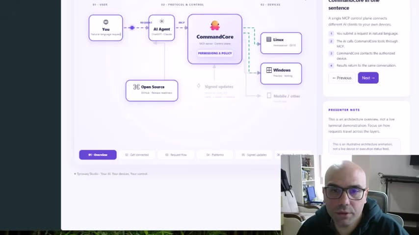
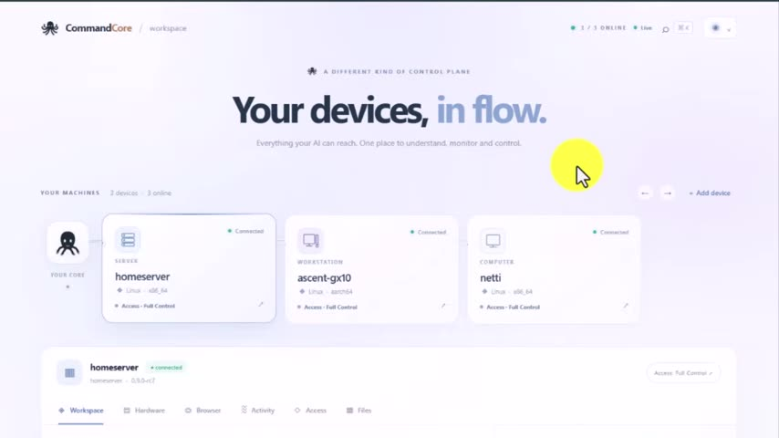
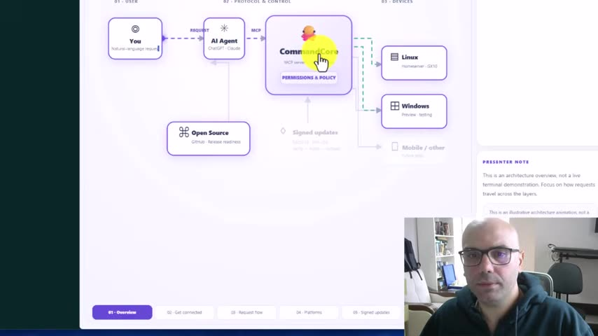
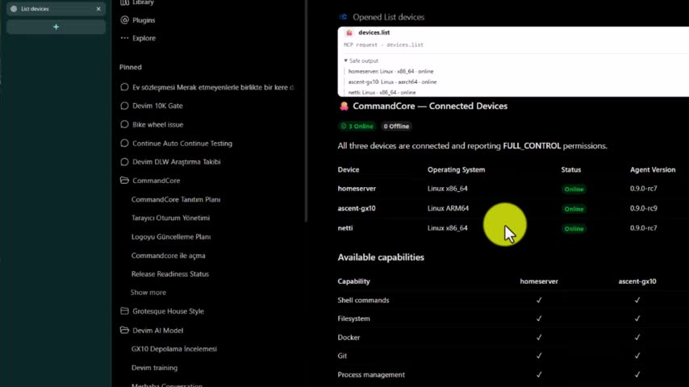
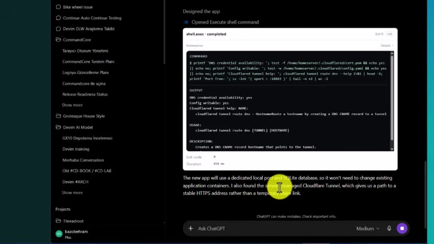
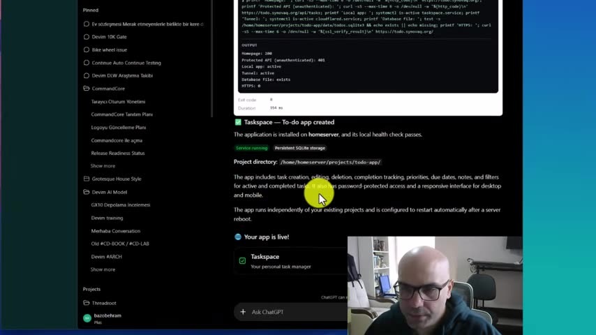
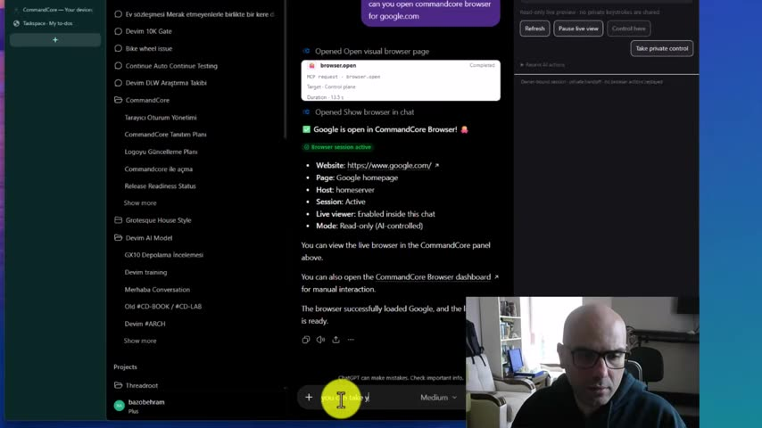
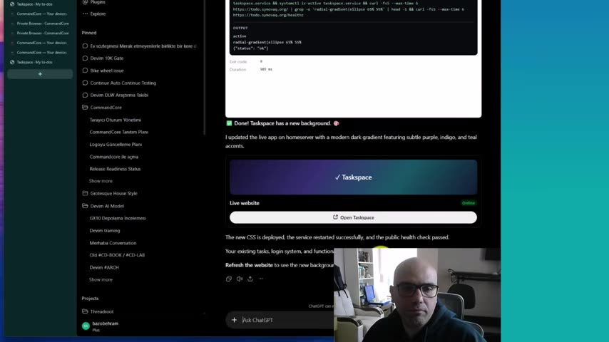

# From a Phone to an Entire Fleet: Why I Built CommandCore

*Your AI. Your devices. Your control.*

**A real-world introduction to an open-source, self-hosted control plane for AI agents — with installation guidance, architecture, security boundaries, and an actual video walkthrough.**

[**Explore CommandCore**](https://commandcore.app/) · [**Source code**](https://github.com/bazobehram/commandcore) · [**Watch the full YouTube demo**](https://youtu.be/kRVtG7oW1aQ) · [**Read the documentation**](https://github.com/bazobehram/commandcore/tree/main/docs)

> **Editor's note — Article V1, November 2026.** Every screenshot in this article is a frame captured from the actual CommandCore demonstration video, not an AI-generated mockup. Some frames include the original presenter camera overlay and the interface as it appeared during recording. This is a working editorial draft, not a claim that every platform or experimental feature has reached general availability.

*Figure 1. An actual frame from the CommandCore demo: the idea is to connect an AI client through one control plane to machines that remain under your ownership. [Watch this moment in the video](https://youtu.be/kRVtG7oW1aQ?t=40).*

## I wanted AI to work where my work actually lives

I spend an enormous amount of time researching, writing code, developing ideas, and building projects. But I am not always sitting in front of a desk.

Sometimes I am walking. Sometimes I am traveling. Sometimes the only device in my hand is my phone.

That should not stop the work.

I already have computers that can do things: a home server that runs my applications, a workstation I use for AI development, and other machines that have their own roles. The hardware exists. The software exists. The files, projects, terminals, and services exist. The missing piece was a way for my AI assistant to reach the right machine, with the right permission, at the right moment.

I did not want a different remote-control integration for every computer, or to keep moving project files into whichever chatbot happened to be open.

**I wanted to speak to an AI agent and have it work on my own devices — without giving up ownership of the devices or control over what the agent is allowed to do.**

That is why I started building **CommandCore**.

## One AI conversation. Multiple machines.

Imagine asking your assistant to check your server's health while you are away from home.

You could go further:

- Ask which computers are connected and what each one can do.
- Inspect a project directory, a running service, or a failed job.
- Read a log, identify a problem, and review a proposed fix.
- Authorize an operation on one selected machine, rather than handing the AI unrestricted access to your entire network.

The essential point is that *the AI client and the computer doing the work are separate.*

The agent is not magically running inside ChatGPT. CommandCore sits between the AI client and your enrolled machines. It authenticates requests, selects the right device, checks permissions, routes operations, and records the result.

*Figure 2. The real Workspace device view from the demonstration. The screenshot shows several distinct machines rather than one generic remote terminal. [Video moment](https://youtu.be/kRVtG7oW1aQ?t=340).*

My setup includes machines with different jobs. The homeserver is a place to run personal services and projects; an AI workstation is a separate resource for heavy model work. CommandCore gives me a single place to reach them without pretending they are the same computer.

The distinction matters. A device may be online but have no desktop session. Another may offer a terminal but not a browser. Another may be able to perform a read-only inspection but not alter services. The interface should expose the *actual* capabilities and authority of each machine.

## The architecture: AI clients connect to CommandCore, not directly to every device

CommandCore uses **Model Context Protocol (MCP)** as its AI-facing integration. That matters because the design is not tied to a single model vendor.

The intended flow is simple:

\`\`\`text
ChatGPT / Claude / Gemini / Codex / another MCP client
                         |
                 HTTPS + OAuth/OIDC
                         |
                  CommandCore MCP
               identity · device grants
               permissions · jobs · audit
                         |
                 authenticated outbound WSS
                         |
                enrolled device Agents
                         |
              files · shell · processes · Git
                   system information
\`\`\`

Every managed device runs an Agent that establishes an **outbound** connection to CommandCore. You do not need to expose an inbound SSH or shell port on every machine just to make it reachable by the AI client.

The server holds the registry, device grants, job routing, and audit records. The Agent holds its own device identity and enforces a local maximum permission level. A selected device can be addressed through a logical selection handle rather than relying on the assistant to remember hostnames.

*Figure 3. The architecture presented in the real walkthrough, with a demonstration view rather than a generated illustration. [Video moment](https://youtu.be/kRVtG7oW1aQ?t=960).*

The [architecture reference](https://github.com/bazobehram/commandcore/blob/main/docs/ARCHITECTURE.md), [MCP contract](https://github.com/bazobehram/commandcore/blob/main/docs/MCP_CONTRACT.md), and [device protocol](https://github.com/bazobehram/commandcore/blob/main/docs/DEVICE_PROTOCOL.md) document these boundaries in more detail.

## What it looks like in a real AI conversation

Here is where the idea stops being a diagram.

In the demonstration, I move from the CommandCore interface to an AI conversation and work with connected machines. The model can request the list of authorized devices, select one, inspect its state, and request an operation through the MCP tools.

*Figure 4. A real AI-client interaction showing connected-device information. [Video moment](https://youtu.be/kRVtG7oW1aQ?t=480).*

That is different from an assistant merely telling me what command I should copy into a terminal.

I can ask the assistant to perform an authorized operation, and the system can return the execution result. The AI is the conversational interface; CommandCore is the permissioned path to the computer.

*Figure 5. A real execution step from the walkthrough. An operation is a visible action with results, not an invisible promise that the AI handled something. [Video moment](https://youtu.be/kRVtG7oW1aQ?t=640).*

*Figure 6. A second live workflow: inspect what the assistant requested and what the remote system returned. [Video moment](https://youtu.be/kRVtG7oW1aQ?t=800).*

One of my strongest preferences is that a tool should **show its work**. If it executes a command, I want the action and its result to be inspectable. If something is blocked by policy, I want an understandable explanation. If a long-running process is still active, I want a real status, not an invented success message.

That is why activity visibility and managed jobs are part of the project, rather than an afterthought.

## Control is not the same as unrestricted access

Remote execution is powerful. An AI capable of reading files, operating a terminal, and changing services should not receive unlimited privileges simply because it authenticated.

CommandCore has three permission profiles:

| Profile | What it means |
| --- | --- |
| **READ_ONLY** | Inspect permitted state and files |
| **STANDARD** | Work with the authority of the Agent's operating-system user |
| **FULL_CONTROL** | Explicitly opt into selected privileged operations through a locally controlled helper |

The effective authority is the intersection of the **OAuth execution scope**, the **account-to-device grant**, the **server permission profile**, and the **device-local ceiling**.

That last boundary is important. A server-side request should not be able to raise a device's local maximum permission without the corresponding local authorization.

A connected device is also not automatically available to every authenticated user. Enrollment and account access are separate decisions.

On Linux, the normal Agent stays unprivileged. Privileged operations use a separate local helper with additional checks when FULL_CONTROL is explicitly configured.

The security documentation goes deeper into [device identity](https://github.com/bazobehram/commandcore/blob/main/docs/SECURITY_MODEL.md), [permissions](https://github.com/bazobehram/commandcore/blob/main/docs/PERMISSIONS.md), the [threat model](https://github.com/bazobehram/commandcore/blob/main/docs/THREAT_MODEL.md), and [signed Agent updates](https://github.com/bazobehram/commandcore/blob/main/docs/AGENT_UPDATE.md).

**A note I do not want to hide:** STANDARD access is already powerful. It has the authority of the user running the Agent. Anyone deploying this should choose the Agent account and device grants deliberately, particularly on important machines.

## Self-hosting: keeping the center of control under your roof

I run personal tools and services on my own infrastructure. I wanted the control plane to fit that approach too.

CommandCore is self-hostable. The server, Agent, protocol implementation, and deployment tooling live in the open-source repository. You decide where the server runs, what domain it uses, which OAuth provider protects it, and which devices are enrolled.

The public website is a starting point:

**[commandcore.app](https://commandcore.app/)**

The source and deployment documentation are here:

**[github.com/bazobehram/commandcore](https://github.com/bazobehram/commandcore)**

*Figure 7. Real work inside the demonstrated system. The goal is to keep both the AI action and the device context visible. [Video moment](https://youtu.be/kRVtG7oW1aQ?t=1130).*

### A first local installation

For an operator comfortable with Linux and Docker Compose, the repository's local evaluation path starts with:

\`\`\`bash
git clone https://github.com/bazobehram/commandcore.git
cd commandcore
cp .env.example .env

# Generate two *different* secrets:
./scripts/generate-secret.sh
./scripts/generate-secret.sh

# Put them in .env as COMMANDCORE_API_TOKEN
# and COMMANDCORE_PANEL_SESSION_SECRET.
# Configure your deployment URLs in .env.

docker compose up -d --build
docker compose ps
curl -fsS http://127.0.0.1:8787/healthz
\`\`\`

This is the **server**, not yet an enrolled device. Starting the server does not automatically grant an AI agent control of that server or any other machine.

Also, a passing local health check is **not** proof that a secure remote deployment is complete. External access needs HTTPS/WSS, correct public URLs, a compatible OAuth/OIDC provider, properly configured grants, and a real acceptance test.

Follow the canonical [self-hosting guide](https://github.com/bazobehram/commandcore/blob/main/docs/SELF_HOSTING.md), [installation guide](https://github.com/bazobehram/commandcore/blob/main/docs/INSTALLATION.md), and [installation-readiness notes](https://github.com/bazobehram/commandcore/blob/main/docs/INSTALLATION_READINESS.md) for current details.

### Adding a Linux device

A configured deployment **may** publish a signed Linux installer at:

\`\`\`bash
curl -fsSL https://YOUR-COMMANDCORE-DOMAIN/install/linux \
  | sh -s -- --server https://YOUR-COMMANDCORE-DOMAIN
\`\`\`

This is not a universal installer at the public demo website. The deployment operator must first publish the signed release feed and pinned installer. A fresh default Compose server can legitimately return **404** for that path.

If you are evaluating the software from source instead, the documentation describes a reviewed-checkout workflow for a Linux Agent. Enrollment requires the operator to approve the device and separately grant access.

**[Read the full Linux Agent installation guide](https://github.com/bazobehram/commandcore/blob/main/docs/INSTALLATION.md)**

### Connecting an MCP client

For a properly configured deployment, use its MCP URL:

\`\`\`text
https://YOUR-COMMANDCORE-DOMAIN/mcp
\`\`\`

Authenticate through the configured OAuth flow, start with the narrowest practical scope, and grant only the devices needed.

A good first acceptance sequence is: inspect your authenticated identity; list devices; select a harmless test device; inspect system information; read a safe file such as \`/etc/hostname\`; confirm that the audit trail shows the correct account and machine.

If you use ChatGPT, start with the [ChatGPT integration guide](https://github.com/bazobehram/commandcore/blob/main/docs/clients/CHATGPT.md). Separate guides exist for [Claude](https://github.com/bazobehram/commandcore/blob/main/docs/clients/CLAUDE.md), [Gemini](https://github.com/bazobehram/commandcore/blob/main/docs/clients/GEMINI.md), [Codex](https://github.com/bazobehram/commandcore/blob/main/docs/clients/CODEX.md), and [generic MCP clients](https://github.com/bazobehram/commandcore/blob/main/docs/clients/GENERIC_MCP.md).

## Could I install CommandCore with an AI agent?

This is one of the more interesting possibilities.

If a capable coding agent already has access to the intended server, I should be able to ask it to inspect the machine, clone the project, read the documentation, configure the deployment, and verify the result.

The repository includes an \`AGENTS.md\` file and a dedicated [agent-assisted installation guide](https://github.com/bazobehram/commandcore/blob/main/docs/AGENT_ASSISTED_INSTALL.md).

A compact starting prompt is:

> Clone https://github.com/bazobehram/commandcore.git and read AGENTS.md. Inspect this Linux machine, then prepare a local-only CommandCore installation using the documented Docker Compose workflow. Generate unique secrets, keep the application on loopback, do not expose new public ports or enable FULL_CONTROL, and verify /healthz. Report exactly what worked and what still requires my approval.

For a real internet-facing installation, the agent must also stop for decisions it cannot make on your behalf: DNS ownership, OAuth provider configuration, MFA, account consent, and permission grants.

That is not a limitation to work around. Those are the boundaries that keep the infrastructure yours.

## What is ready today — and what is not?

I want the project to be useful, but I also want to be precise about the current release status.

As documented in the repository's **0.9 release-candidate** family:

- **Linux x86_64 and ARM64** are the primary candidate platforms; the Rust Agent is the preferred native runtime.
- **Windows** is still a preview, with important real-runtime lifecycle acceptance work remaining.
- **macOS** does not yet have a supported Agent release.
- **Interactive desktop control** is experimental, not a stable platform promise.
- The **managed Browser** is optional and has its own security and deployment boundaries.
- A signed installer is available only where a deployment has actually published and configured the corresponding signed release feed.

This distinction matters when people are trusting software to touch their computers.

For the most current evidence and limitations, read the [platform support matrix](https://github.com/bazobehram/commandcore/blob/main/docs/PLATFORM_SUPPORT.md), [validation notes](https://github.com/bazobehram/commandcore/blob/main/docs/VALIDATION_RESULTS.md), and [release checklist](https://github.com/bazobehram/commandcore/blob/main/docs/PUBLIC_RELEASE_CHECKLIST.md).

*Figure 8. The later part of the real demonstration returns to the actual AI-client workflow, with tools and results visible. [Video moment](https://youtu.be/kRVtG7oW1aQ?t=1320).*

## Open source means you can inspect it, improve it, and run it yourself

CommandCore is released under the **GNU AGPL-3.0-or-later** license.

The goal is not to build a black box that asks you to trust it with your machines. It is to build a control plane whose behavior, security boundaries, installation process, and limitations can be inspected.

If you want to contribute, start with the [repository](https://github.com/bazobehram/commandcore), [contribution guidelines](https://github.com/bazobehram/commandcore/blob/main/CONTRIBUTING.md), and [open issues](https://github.com/bazobehram/commandcore/issues).

Code contributions pass through pull requests and CI. Security issues should follow the [private disclosure policy](https://github.com/bazobehram/commandcore/blob/main/SECURITY.md), not a public issue.

If you are interested in MCP, self-hosting, device authorization, Linux Agents, Rust, frontend experience, browser isolation, or signed software updates, there are meaningful areas to explore.

## Watch the real walkthrough

The article is the explanation. The video is the demonstration.

**[Watch CommandCore in action on YouTube](https://youtu.be/kRVtG7oW1aQ)**

You can see the Workspace, enrolled machines, AI-client interactions, and real execution paths rather than only a concept design.

I built CommandCore because I wanted to carry my work with me without carrying all my computers with me. My phone should be enough to ask the right question. My own machines should do the work. And I should remain the person deciding what the AI is allowed to access.

That is the direction I want to keep building.

**Your AI. Your devices. Your control.**

---

### Links and references

- **Website:** https://commandcore.app/
- **GitHub / source:** https://github.com/bazobehram/commandcore
- **Full video demonstration:** https://youtu.be/kRVtG7oW1aQ
- **Documentation:** https://github.com/bazobehram/commandcore/tree/main/docs
- **Getting started:** https://github.com/bazobehram/commandcore/blob/main/README.md
- **Installation:** https://github.com/bazobehram/commandcore/blob/main/docs/INSTALLATION.md
- **Agent-assisted setup:** https://github.com/bazobehram/commandcore/blob/main/docs/AGENT_ASSISTED_INSTALL.md
- **Security:** https://github.com/bazobehram/commandcore/blob/main/docs/SECURITY_MODEL.md
- **Supported platforms:** https://github.com/bazobehram/commandcore/blob/main/docs/PLATFORM_SUPPORT.md
- **Contribution guide:** https://github.com/bazobehram/commandcore/blob/main/CONTRIBUTING.md
- **License:** https://github.com/bazobehram/commandcore/blob/main/LICENSE

*Visual source attribution: all eight numbered screenshots are unmodified frames from the linked CommandCore YouTube demo. V1 uses the video as its verified visual source; V2 can add fresh high-resolution native screenshots of current public onboarding, enrollment, permission dialogs, and Activity/Browser views after each image is reviewed for sensitive data.*

